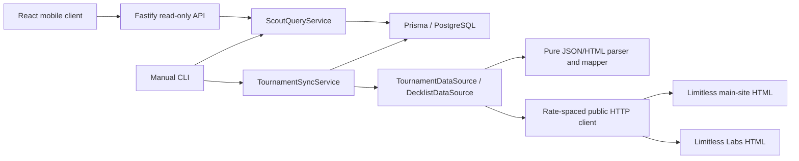

# Architecture

This monorepo contains shared contracts, public data adapters, PostgreSQL persistence, reusable application services, a read-only Fastify API and the Milestone 4 React mobile client.

- `apps/web`: React/TypeScript historical lookup, same-origin API client, mobile styling and browser tests; no data-source access.
- `packages/shared`: source-neutral records, name normalization, source identity helpers, adapter interfaces and JSON query projections.
- `packages/data-sources`: separate Labs and Main clients, parsers and mappers; fixtures include multiple origins/divisions. External HTTP access belongs here.
- `packages/database`: Prisma schema, committed SQL migrations, generated client (ignored), connection configuration. Uses PostgreSQL via the Prisma pg adapter.
- `packages/application`: synchronization, bounded expansion/reconciliation, identity reviews, duplicate candidates and query services. No transport or frontend dependencies. Source-location validation keeps Labs and Main namespaces separate.
- `scripts`: argument validation, database availability checks and service invocation. No source HTTP calls in CLI/controllers.

## Persistence and identity

Player owns source identities and name aliases. A unique `(source, scope, externalId)` identifies a source account; Labs global player_id is verified as cross-tournament, while tp_id is scoped to a tournament/division. Tournament is unique by source/externalId/division, entry by tournament/externalId, deck by entry, and cards by deck/row position. Row position preserves distinct source print rows without deduplicating by similar names. Source identity changes on existing entries require review.

Name search computes a punctuation-tolerant key but never joins identities by name or country. Possible matches remain separate query results. A future adapter without a verified global ID must supply an event-scoped identityScope and a source-local entry identifier; it must never manufacture a global name ID.

Each imported result retains its source URL, source identifiers, source-local player ID, original event name/country and retrieval time. Tournament raw metadata and entry raw source rows are JSON; rawList retains validated source card rows and the list reference. Date labels are stored verbatim; startsAt is nullable and only accepts an explicit ISO instant. Ambiguous source timestamps are retained in raw metadata, not assigned an invented timezone. Formats remain nullable, with explicit operator overrides supported.

## Synchronization boundaries

SyncRun is durable before retrieval. Existing events are linked before fetching, so a failed refresh remains visible in tournament listings. Header validation precedes tournament updates. Each entry transaction locks only its source identity, then upserts identity/player, alias, result and archetype metadata. Each list is validated before a short transaction replaces its card rows. Network requests occur outside database transactions.

A partial unique index permits one RUNNING run per source event/division. No long transaction covers an entire tournament or a network request. Unique constraints and advisory locks handle concurrent identity appearances across different events. If the process/database is lost, manual run recovery is required; see README.

SUCCESS means the source is completed, the snapshot entry count matches the source count, every received entry was saved, no previously stored entries were omitted, and all currently available lists were imported. PARTIAL records count mismatches, entry/list failures, uncompleted events or capped pending lists. FAILED records retrieval/header/database failure. Missing fields preserve known values; missing old entries are not deleted. Public source completion is not the same as fullySynchronized.

JSON snapshots are validation/reconciliation evidence; they do not imply official final standings. The source can correct results, change labels or split identities. Imported lists are reused by default; automatically refreshing/reconciling already imported cards is deferred.

## Tests

Offline tests cover parsers, source metadata, null countries, division URLs, source print identifiers, normalization and deck validation. PostgreSQL tests apply the actual migration in an isolated random schema and cover idempotency, aliases, ambiguous players, partial/failing imports, list states, constraints, transaction rollback and query services. Custom CHECK constraints and the partial RUNNING index are maintained in reviewed SQL migrations; Prisma schema syntax cannot express all of them.

Explicit null/zero global Labs player IDs fall back to a tournament/division-scoped identity, so unknown identities cannot collapse into one player. An entirely absent player_id field is still treated as a malformed source payload, preserving Milestone 1 validation behavior. Fallback behavior is covered by synthetic offline/database tests; all inspected real sample IDs were positive.

## Milestone 3 additions

apps/api contains a dependency-injected Fastify factory and loopback launcher. GET routes validate with Zod and delegate to query/identity comparison services. No route retrieves source data. IdentityReview stores append-only human assessments without changing source ownership. DecklistReview stores before/after evidence of bounded explicit reconciliation, using the existing SyncRun event exclusion and atomic card replacement. History queries are paginated. See milestone-3.md for contracts and limitations.

## Milestone 3.5 extension

LimitlessMainSource is an independent adapter for selected published main-site results. HistoricalExpansionService previews/applies explicit selections of at most six events, with a cumulative one-list budget per event checked under the existing RUNNING exclusion. Unknown division/season/completion/records are nullable; resultsCoverage and approximate counts distinguish selected publication from complete standings. Calendar eventDate does not invent a timezone.

Source duplicate candidate tables preserve both event/result references and never merge players or certify extra appearances. History and identity comparison expose these advisory links and label counts as published source results. Regional format labels, original Unicode names, event versus player country and source printing language stay separate. See milestone-3.5.md for the verified selection and limitations. The API continues to call query services only.

## Milestone 5: evidence projections

The mobile comparison uses `IdentityReviewService.compareForDisplay` through the existing comparison GET route with `view=summary`. It projects source identities, bounded historical results, archetypes and recorded reviews without raw snapshots, and reports exact review/history limits. The original CLI/inspection comparison remains compatible. `DuplicateQueryService` exposes one existing event/result candidate pair through GET routes with explicit field selections and bounded detection signals. No route detects candidates, retrieves external data, records reviews or merges identities. Shared evidence contracts carry ISO JSON timestamps. Search selection and comparison/duplicate screens preserve navigation locally in React; the services retain identity/overlap interpretation.

## Milestone 6: historical summaries

`ScoutingQueryService` reads the selected identity's complete projected history in a repeatable-read transaction. Shared pure analysis applies calendar/source-format/division filters, conservative candidate exclusion and source-scoped archetype grouping before pagination. The summary and paginated evidence routes use the same pipeline and return a revision of the relevant projected data. React displays the server's counts/percentages and checks revisions; it never derives frequencies from a page. Source snapshots and full card lists are excluded from these responses. The original history/list routes remain compatible. No schema or ingestion changes were needed.

## Explicit catalog expansion

Catalog adapters parse finite public Labs/Main indexes into persisted URL selections.
`CatalogImportService` previews against successful complete-result `SyncRun` markers
without HTTP, then delegates each pending URL to its existing source adapter and
`TournamentSyncService`. Bulk runs have zero new-list budget and bounded local
entry concurrency; HTTP stays serial, cached and paced. The old six-event sample
service remains available separately. `/tournament-catalog` is a read-only projected,
paginated database query, independent of external discovery/import.

The React sprite component uses a committed local sheet and species alias map.
It changes presentation only: names, source taxonomy, identity and ingestion
contracts remain independent of decorative sprite matching.
